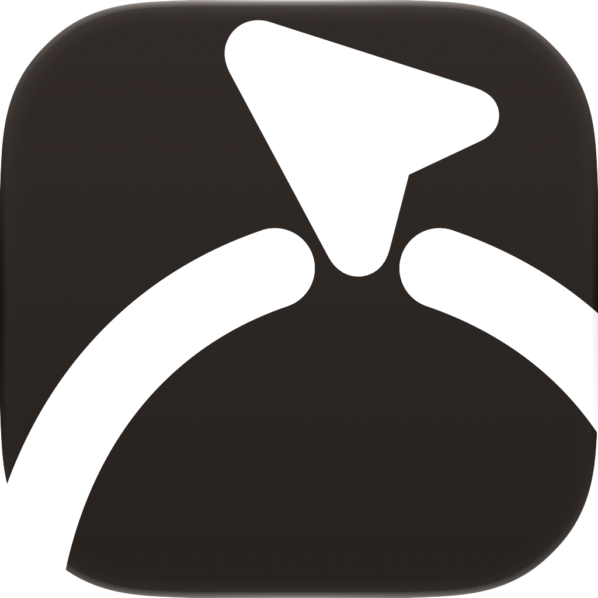
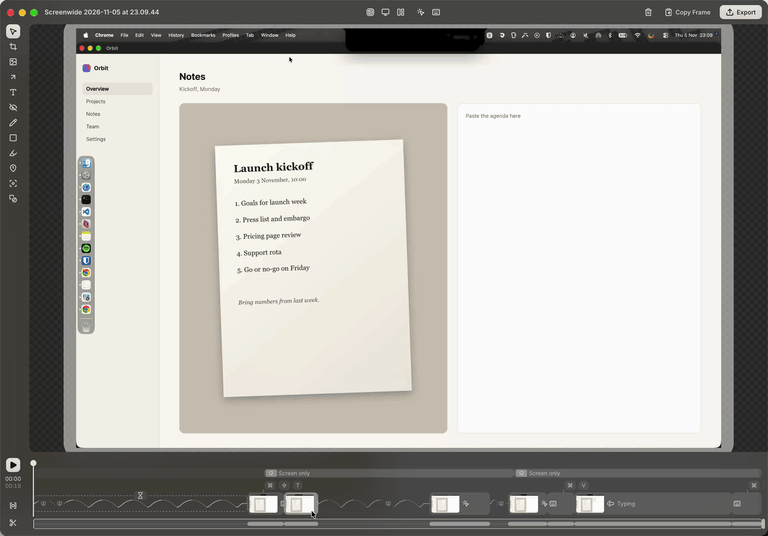
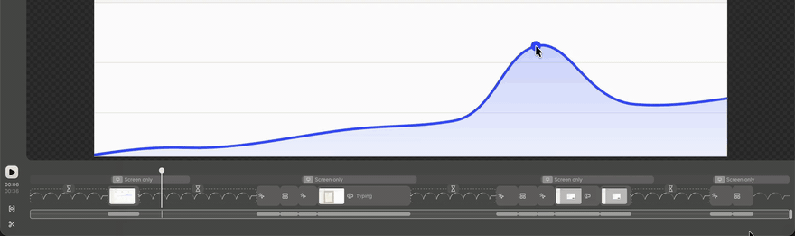
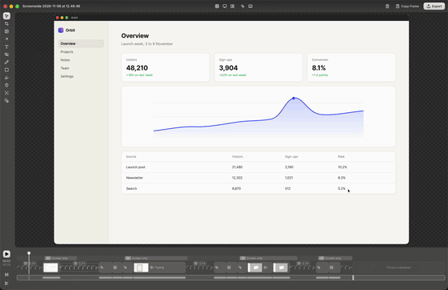
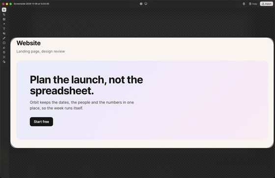
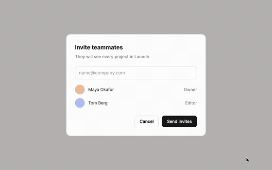
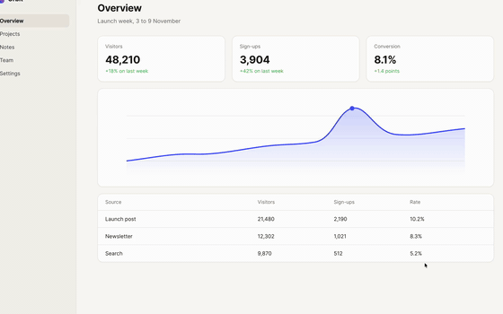
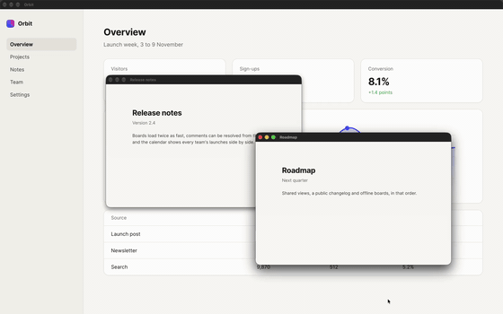
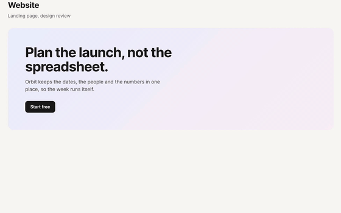

<!-- SPDX-FileCopyrightText: 2026 overpolish -->
<!-- SPDX-License-Identifier: GPL-3.0-or-later -->

	
	<h1>Screenwide</h1>
	
Everything screen.

	
<a href="https://getscreenwide.com">getscreenwide.com</a>

	
	
	

 

## Recording

Record a display, a window or part of the screen, with your camera, microphone and the computer's sound. A replay buffer keeps the last 30 seconds, for when something worth keeping has just happened.

## Beats and lulls

The timeline splits a recording into beats, where something happens, and lulls, where nothing does. One handle squeezes every lull at once while the beats play at full speed. A lull can also be cut, kept as recorded or trimmed to a breath.

## Annotations

Magnify a detail, put one part in focus, spotlight or redact it, and add arrows, counters, highlights and text, on recordings and screenshots alike.

<table>
	<tr>
		<td> On a recording</td>
		<td> On a screenshot</td>
	</tr>
</table>

## Free and paid

Recording, editing, screenshots and text recognition are free. Ruler, Annotate, Glide and References are paid tools: each is free for 14 days, then a one-off purchase from Settings › Licences, on its own or all together.

<table>
	<tr>
		<td> Ruler</td>
		<td> Annotate</td>
	</tr>
	<tr>
		<td> Glide</td>
		<td> References</td>
	</tr>
</table>

## Download

Download Screenwide from [getscreenwide.com](https://getscreenwide.com), or get any version from [Releases](https://github.com/overpolish/screenwide/releases).

## Building

See [CONTRIBUTING.md](CONTRIBUTING.md).

## Licence

Screenwide is under the [GPL, version 3 or later](LICENSE). The paid tools and their licence check are under the [Elastic License 2.0](LICENSES/Elastic-2.0.txt): you can read and change their source, but not remove the licence check or offer the tools as a service. Buying a tool gives you the [Screenwide Tools Licence](TOOLS-LICENSE.md). Each file's SPDX header says which licence covers it. FFmpeg ships beside the app as a separate GPL program ([FFMPEG.md](FFMPEG.md)).
