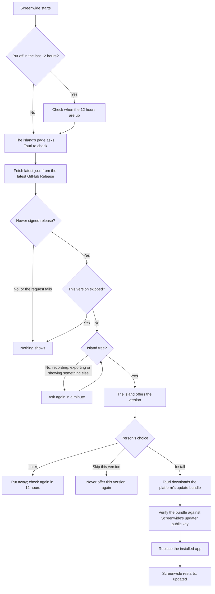

<!--
SPDX-FileCopyrightText: 2026 overpolish
SPDX-License-Identifier: GPL-3.0-or-later
-->

# Releasing Screenwide

Screenwide publishes the macOS app and its signed Tauri updater bundle through GitHub Releases, and releases Windows only through the Microsoft Store. A pushed version tag builds native Apple Silicon macOS, Windows x64, and Windows ARM64 artifacts. Intel macOS is not supported. The workflow creates a draft release so the files and release notes can be checked before users' apps see it.

## User update flow

The macOS app offers updates on its island; Tauri shows no update dialog of its own. On launch the island's page asks Tauri for the latest GitHub Release, unless the person put an update off less than 12 hours ago, in which case it checks once those hours are up. **Check for Updates**, in the About group at the end of Settings' General pane, checks at any time and opens the release notes with the offer. The Windows app comes from the Microsoft Store, which installs its updates; it never contacts the update endpoint, but asks the Store instead and offers what it finds the same way, with **Open Microsoft Store** in place of Install (see [Microsoft Store](#microsoft-store)).



Nothing downloads until Install. The island says which version is out and when it was released; **What's new** opens its release notes under the island, with **Skip this version** beneath them. The notes are GitHub's sanitized, rendered release description for that tag, not a second copy kept in `latest.json`, and their links open in the browser. While the update downloads the island shows its progress, and a failed install offers **Try again**.

- Tauri replaces the installed application and Screenwide relaunches it.
- Development builds never contact the update endpoint, because `tauri dev` launches through a symlink, which is unsafe to update in place.

The updater's metadata and downloads come from the public GitHub Release, but Tauri accepts an update only when its updater signature matches the public key built into Screenwide. Apple's code signing and notarization are a separate trust layer of the operating system.

## One-time repository setup

Add these GitHub Actions repository secrets:

- `TAURI_SIGNING_PRIVATE_KEY`: the complete contents of the Screenwide updater private key. The maintainer copy is at `~/.tauri/screenwide.key`.
- `TAURI_SIGNING_PRIVATE_KEY_PASSWORD`: not required for the current unencrypted key. Add it only if the updater key is replaced with an encrypted one.
- `APPLE_CERTIFICATE`: a Developer ID Application `.p12` exported from Keychain Access and encoded with `openssl base64 -A -in certificate.p12`.
- `APPLE_CERTIFICATE_PASSWORD`: the password used when exporting that `.p12`.
- `APPLE_SIGNING_IDENTITY`: the certificate name reported by `security find-identity -v -p codesigning`.
- `APPLE_ID`: the Apple ID used for notarization.
- `APPLE_PASSWORD`: an app-specific password for that Apple ID.
- `APPLE_TEAM_ID`: the Apple Developer Team ID.

For the currently installed Screenwide signing certificate, use these exact values without surrounding quotes:

```text
APPLE_SIGNING_IDENTITY=Developer ID Application: Domingas Pleckauskas (378WQ9W95U)
APPLE_TEAM_ID=378WQ9W95U
```

The updater public key is intentionally committed in `src-tauri/tauri.conf.json`. Never commit the private key. Back it up securely: losing it prevents existing installations from accepting future updates.

The project has no Windows code-signing certificate, so it ships no Windows installer: an unsigned one meets SmartScreen's warning, and Smart App Control blocks it. The Store signs the packages it distributes.

## Make a release

1. Update the version in `package.json`, `src-tauri/Cargo.toml`, and `src-tauri/tauri.conf.json`.
2. Run `pnpm release:check-version` and `pnpm check`.
3. Commit the version change, then tag and push it:

   ```sh
   git tag v0.2.0
   git push origin v0.2.0
   ```

4. Wait for the Release workflow to finish, including the **Verify updater assets** job. In the draft GitHub Release, verify the Apple Silicon macOS DMG (`Screenwide_aarch64.dmg`, the name the website's download button links to), its signed updater bundle, `latest.json` (macOS only), and both Microsoft Store packages (`.msix`, not made for prereleases).
5. Edit the generated notes if needed, then publish the draft. Publishing makes it the endpoint served by `releases/latest/download/latest.json`, so installed copies can offer it, and starts the Microsoft Store workflow (below). The notes are what the update offer and the Store's What's new show, so write them for the people using the app. GitHub fills them only with merged pull requests, of which this repository has none.

Do not publish a partially successful release. Rerun failed jobs or delete the draft and tag, correct the issue, and create a new version.

## Microsoft Store

The Store installs and updates its own copy of Screenwide from an MSIX package. Tauri makes none, so `pnpm msix:package` (`scripts/package-msix.mjs`) lays out a Windows release build as Tauri's Windows installer would, adds the Store logos and the manifest (`src-tauri/msix/AppxManifest.xml`), and packs it with the Windows SDK's makeappx. The manifest carries the identity Partner Center reserved for Screenwide (`overpolish.Screenwide`, Store ID `9MSN8CRH5W0F`); the Store rejects a package whose identity differs. The Release workflow attaches the x64 and ARM64 packages to the draft release.

The taskbar and Start show the small logo at the sizes in `src-tauri/msix/Assets` (`Square44x44Logo.targetsize-*_altform-unplated.png`), listed in the package's `resources.pri`, which the script builds with the SDK's makepri. Without them Windows draws the 44 px logo shrunk on a tile of the accent colour.

A packaged copy knows it is one (`src-tauri/src/microsoft_store.rs`): it does not update itself, and it launches at login through the package's startup task rather than the autostart plugin, whose registry entry Windows redirects for packaged apps. Windows lets only the package's own processes execute the files in its install folder, so the window hider is loaded into the apps being hidden from a copy in the package's cache folder (`src-tauri/src/hidden_apps_windows/shared_library.rs`).

A packaged copy checks for updates as the macOS app does, but asks the Store (`src-tauri/src/microsoft_store/updates.rs`). `StoreContext` says whether the Store has an update for the installed package but not which version: the update it lists names the installed package. The version comes from the Store's public catalog (`displaycatalog.mp.microsoft.com`), which is undocumented; when it cannot be read, or does not yet list a version newer than the one installed, the offer names no version, shows no release notes and cannot be skipped. With a version, the release notes are those of the GitHub Release for that tag, as on macOS. **Open Microsoft Store** opens Screenwide's Store page, where the person installs it; the app never installs the update itself. A Store copy finds updates only once it was installed from the Store: a folder registered for testing finds none. To try the offer against the real Store, install Screenwide from the Store, keep that copy older than the latest Store release, and start a build in its package context with `Invoke-CommandInDesktopPackage -PackageFamilyName overpolish.Screenwide_y93s1f9758jx8 -AppId Screenwide -Command <path to screenwide.exe>`.

Publishing a GitHub release submits it to the Store (`.github/workflows/store.yml`): the workflow bundles both `.msix` packages into one upload, replaces the last release's packages with it, sets What's new from the release notes and commits the submission, which starts certification. Partner Center shows a submission made through the API only once it is committed, and changing such a submission in Partner Center can leave it stuck, so make changes through the workflow, not by hand. The submission is kept on manual publishing: once it passes certification, it waits for **Publish now** in Partner Center. To submit a release again, run the workflow by hand with its tag (`gh workflow run store.yml -f tag=v1.0.1`); msstore deletes a submission still in progress before making its own. The Store signs the packages. The listing's privacy policy is <https://getscreenwide.com/privacy>, and the `runFullTrust` capability needs a line saying why: Screenwide captures the screen, hides chosen windows from capture and moves other apps' windows, which a sandboxed app cannot.

To try a package before submitting it, on Windows with developer mode turned on, build it and register its folder, which installs it unsigned under its package identity. The build skips Tauri's bundles, which need the updater's signing key and which the package does not use:

```powershell
pnpm tauri build --target x86_64-pc-windows-msvc --no-bundle
pnpm msix:package --target x86_64-pc-windows-msvc
Add-AppxPackage -Register src-tauri\target\x86_64-pc-windows-msvc\msix\Screenwide\AppxManifest.xml
```

`Get-AppxPackage overpolish.Screenwide | Remove-AppxPackage` removes it.

A registered folder stays where it was built, without the install folder's restrictions, so hiding apps behaves there as in an unpackaged build. To test hiding as the Store installs it, sign the package with a test certificate whose subject is the manifest's `Publisher`, trust that certificate (the import needs an administrator), and install the package itself (with the version being packed in its name):

```powershell
$cert = New-SelfSignedCertificate -Type Custom -Subject "CN=20209A30-FD28-4F20-817F-331CCDE1D196" -KeyUsage DigitalSignature -FriendlyName "Screenwide MSIX test" -CertStoreLocation Cert:\CurrentUser\My -TextExtension @("2.5.29.37={text}1.3.6.1.5.5.7.3.3", "2.5.29.19={text}")
Export-Certificate -Cert $cert -FilePath screenwide-msix-test.cer
Import-Certificate -FilePath screenwide-msix-test.cer -CertStoreLocation Cert:\LocalMachine\TrustedPeople
signtool sign /fd SHA256 /sha1 $cert.Thumbprint src-tauri\target\x86_64-pc-windows-msvc\release\bundle\msix\Screenwide_1.0.0_x64.msix
Add-AppxPackage -Path src-tauri\target\x86_64-pc-windows-msvc\release\bundle\msix\Screenwide_1.0.0_x64.msix
```

## The app icon

`src-tauri/icons/Screenwide.icon` is the icon, made in Icon Composer. macOS reads it compiled (`Assets.car`, by `pnpm macos-icon:prepare` while bundling) with `icon.icns` as the fallback, and draws it on Apple's grid, whose artwork sits inside a margin a tenth of each side wide. Windows and browsers draw an icon file as it is, so theirs are rendered edge to edge: after the icon changes, run `pnpm icons:prepare` on a Mac with Xcode 26 and commit what it writes. It renders the document with Icon Composer's `ictool` into `ScreenwideLogo.png`, the site's `favicon.png` and, through `tauri icon`, the Windows and Linux icons (`icon.ico`, `icon.png`, the sized PNGs, `Square*Logo.png`, `StoreLogo.png`), then the Store's small logos (`pnpm msix-logos:prepare`). It leaves the macOS icon alone.

## Model files

Most models download from their authors' pages on Hugging Face and GitHub (`src-tauri/crates/speech/src/catalogue.rs`). Cutie's three graphs, which Screenwide exported itself, are hosted on this repository's `models-1` release. Every shipped version downloads them from there, so never delete that release, and keep it a pre-release: a full release would become GitHub's latest, and the updater and the website's macOS download read the latest release. New or changed model files go on a new `models-N` pre-release, with the catalogue's URLs moved to it.

## Debugging updates

### Preview the interface

Run the isolated update prompt in Storybook without contacting GitHub or installing anything:

```sh
pnpm update:preview
```

The **Features / Updates / Island / Update** stories show the offer, its release notes open, the download at 42%, the install, and a failed install. Use Storybook's theme control to see it in both appearances.

### Exercise a real staged update

The real updater cannot run against `tauri dev`: its macOS debug executable is launched through a symlink, and Tauri rejects that as an unsafe update target. Test against a published, signed GitHub Release instead. A draft is insufficient because the application cannot download draft assets.

Build an older packaged client against that exact prerelease tag:

```sh
pnpm update:staging -- v0.2.0-rc.1
```

If the tag has the same version as the working tree, the staging command packages the test client as version `0.0.1` without changing any source files. This lets a newly published first release exercise the real updater immediately.

This produces an app with:

- the updater endpoint overridden to `releases/download/v0.2.0-rc.1/latest.json`;
- updater artifact generation disabled for the older test client;
- updater diagnostics enabled; and
- Tauri's release-build devtools feature enabled.

The command makes an `.app`; Windows has no staged updates, since the Store updates it. Additional `tauri build` options can follow the tag. Launch the packaged client directly, then open its Web Inspector with **Command–Option–I**. Updater decisions are prefixed with `[Screenwide updater]`.

Reset reminder and skip decisions from the Web Inspector console when repeating a scenario:

```js
localStorage.removeItem("screenwide.updates.remindAfter");
localStorage.removeItem("screenwide.updates.skippedVersion");
```

For a future staged release, use a prerelease version such as `0.2.0-rc.1` in all three version files, tag it `v0.2.0-rc.1`, and publish the workflow's draft as a prerelease. For a release matching the working tree, the staging command's automatic `0.0.1` package version is sufficient. The remote updater bundle must be signed with the same private key whose public key is embedded in the client; Tauri does not permit bypassing signature verification.
