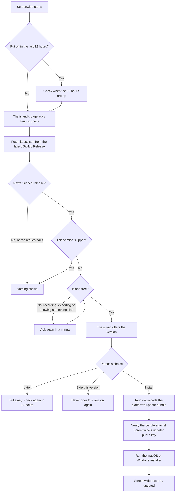

<!--
SPDX-FileCopyrightText: 2026 overpolish
SPDX-License-Identifier: GPL-3.0-or-later
-->

# Releasing Screenwide

Screenwide publishes installers and signed Tauri updater bundles through GitHub Releases, and Microsoft Store packages for Windows. A pushed version tag builds native Apple Silicon macOS, Windows x64, and Windows ARM64 artifacts. Intel macOS is not supported. The workflow creates a draft release so the files and release notes can be checked before users' apps see it.

## User update flow

Screenwide offers updates on its island; Tauri shows no update dialog of its own. On launch the island's page asks Tauri for the latest GitHub Release, unless the person put an update off less than 12 hours ago, in which case it checks once those hours are up. **Check for Updates**, in the About group at the end of Settings' General pane, checks at any time and opens the release notes with the offer.



Nothing downloads until Install. The island says which version is out and when it was released; **What's new** opens its release notes under the island, with **Skip this version** beneath them. The notes are GitHub's sanitized, rendered release description for that tag, not a second copy kept in `latest.json`, and their links open in the browser. While the update downloads the island shows its progress, and a failed install offers **Try again**.

- On macOS, Tauri replaces the installed application and Screenwide relaunches it.
- On Windows, Tauri starts the NSIS installer in `passive` mode. Windows closes Screenwide while the installer replaces it; the installer may show its own small progress window.
- Development builds never contact the update endpoint, because `tauri dev` launches through a symlink, which is unsafe to update in place.

The updater's metadata and downloads come from the public GitHub Release, but Tauri accepts an update only when its updater signature matches the public key built into Screenwide. Apple's code signing and notarization, and Windows' Authenticode signing, are separate trust layers of the operating systems.

## One-time repository setup

Add these GitHub Actions repository secrets:

- `TAURI_SIGNING_PRIVATE_KEY`: the complete contents of the Screenwide updater private key. The maintainer copy is at `~/.tauri/screenwide.key`.
- `TAURI_SIGNING_PRIVATE_KEY_PASSWORD`: not required for the current unencrypted key. Add it only if the updater key is replaced with an encrypted one.
- `APPLE_CERTIFICATE`: a Developer ID Application `.p12` exported from Keychain Access and encoded with `openssl base64 -A -in certificate.p12`.
- `APPLE_CERTIFICATE_PASSWORD`: the password used when exporting that `.p12`.
- `APPLE_SIGNING_IDENTITY`: the certificate name reported by `security find-identity -v -p codesigning`.
- `APPLE_ID`: the Apple ID used for notarization.
- `APPLE_PASSWORD`: an app-specific password for that Apple ID.
- `APPLE_TEAM_ID`: the Apple Developer Team ID.

For the currently installed Screenwide signing certificate, use these exact values without surrounding quotes:

```text
APPLE_SIGNING_IDENTITY=Developer ID Application: Domingas Pleckauskas (378WQ9W95U)
APPLE_TEAM_ID=378WQ9W95U
```

The updater public key is intentionally committed in `src-tauri/tauri.conf.json`. Never commit the private key. Back it up securely: losing it prevents existing installations from accepting future updates.

Windows installers are updater-signed but not yet Authenticode code-signed, so Windows may show a SmartScreen reputation warning until a Windows signing certificate is configured.

## Make a release

1. Update the version in `package.json`, `src-tauri/Cargo.toml`, and `src-tauri/tauri.conf.json`.
2. Run `pnpm release:check-version` and `pnpm check`.
3. Commit the version change, then tag and push it:

   ```sh
   git tag v0.2.0
   git push origin v0.2.0
   ```

4. Wait for the Release workflow to finish, including the **Verify updater assets** job. In the draft GitHub Release, verify the Apple Silicon macOS DMG, both Windows NSIS installers, both Microsoft Store packages (`.msix`, not made for prereleases), signed updater bundles, and `latest.json`.
5. Edit the generated notes if needed, then publish the draft. Publishing makes it the endpoint served by `releases/latest/download/latest.json`, so installed copies can offer it.

Do not publish a partially successful release. Rerun failed jobs or delete the draft and tag, correct the issue, and create a new version.

## Microsoft Store

The Store installs and updates its own copy of Screenwide from an MSIX package. Tauri makes none, so `pnpm msix:package` (`scripts/package-msix.mjs`) lays out a Windows release build as the NSIS installer does, adds the Store logos and the manifest (`src-tauri/msix/AppxManifest.xml`), and packs it with the Windows SDK's makeappx. The manifest carries the identity Partner Center reserved for Screenwide (`overpolish.Screenwide`, Store ID `9MSN8CRH5W0F`); the Store rejects a package whose identity differs. The Release workflow attaches the x64 and ARM64 packages to the draft release.

A packaged copy knows it is one (`src-tauri/src/microsoft_store.rs`): it does not update itself, and Settings says the Store updates it, and it launches at login through the package's startup task rather than the autostart plugin, whose registry entry Windows redirects for packaged apps.

To submit a release, open Screenwide in Partner Center, start a submission and upload both `.msix` files under Packages; the Store signs them. The listing's privacy policy is <https://getscreenwide.com/privacy>, and the `runFullTrust` capability needs a line saying why: Screenwide captures the screen, hides chosen windows from capture and moves other apps' windows, which a sandboxed app cannot.

To try a package before submitting it, on Windows with developer mode turned on, build it and register its folder, which installs it unsigned under its package identity:

```powershell
pnpm tauri build --target x86_64-pc-windows-msvc --bundles nsis
pnpm msix:package --target x86_64-pc-windows-msvc
Add-AppxPackage -Register src-tauri\target\x86_64-pc-windows-msvc\msix\Screenwide\AppxManifest.xml
```

`Get-AppxPackage overpolish.Screenwide | Remove-AppxPackage` removes it.

## Debugging updates

### Preview the interface

Run the isolated update prompt in Storybook without contacting GitHub or installing anything:

```sh
pnpm update:preview
```

The **Features / Updates / Island / Update** stories show the offer, its release notes open, the download at 42%, the install, and a failed install. Use Storybook's theme control to see it in both appearances.

### Exercise a real staged update

The real updater cannot run against `tauri dev`: its macOS debug executable is launched through a symlink, and Tauri rejects that as an unsafe update target. Test against a published, signed GitHub Release instead. A draft is insufficient because the application cannot download draft assets.

Build an older packaged client against that exact prerelease tag:

```sh
pnpm update:staging -- v0.2.0-rc.1
```

If the tag has the same version as the working tree, the staging command packages the test client as version `0.0.1` without changing any source files. This lets a newly published first release exercise the real updater immediately.

This produces an app with:

- the updater endpoint overridden to `releases/download/v0.2.0-rc.1/latest.json`;
- updater artifact generation disabled for the older test client;
- updater diagnostics enabled; and
- Tauri's release-build devtools feature enabled.

On macOS the command defaults to an `.app`; on Windows it defaults to an NSIS installer. Additional `tauri build` options can follow the tag. Launch the packaged client directly, then open its Web Inspector with **Command–Option–I** on macOS or **Ctrl–Shift–I** on Windows. Updater decisions are prefixed with `[Screenwide updater]`.

Reset reminder and skip decisions from the Web Inspector console when repeating a scenario:

```js
localStorage.removeItem("screenwide.updates.remindAfter");
localStorage.removeItem("screenwide.updates.skippedVersion");
```

For a future staged release, use a prerelease version such as `0.2.0-rc.1` in all three version files, tag it `v0.2.0-rc.1`, and publish the workflow's draft as a prerelease. For a release matching the working tree, the staging command's automatic `0.0.1` package version is sufficient. The remote updater bundle must be signed with the same private key whose public key is embedded in the client; Tauri does not permit bypassing signature verification.
