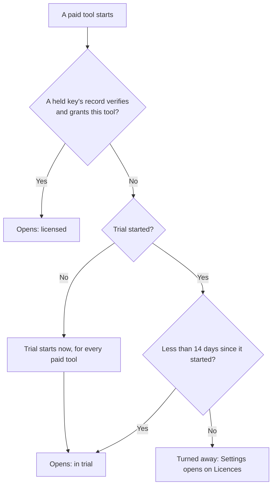
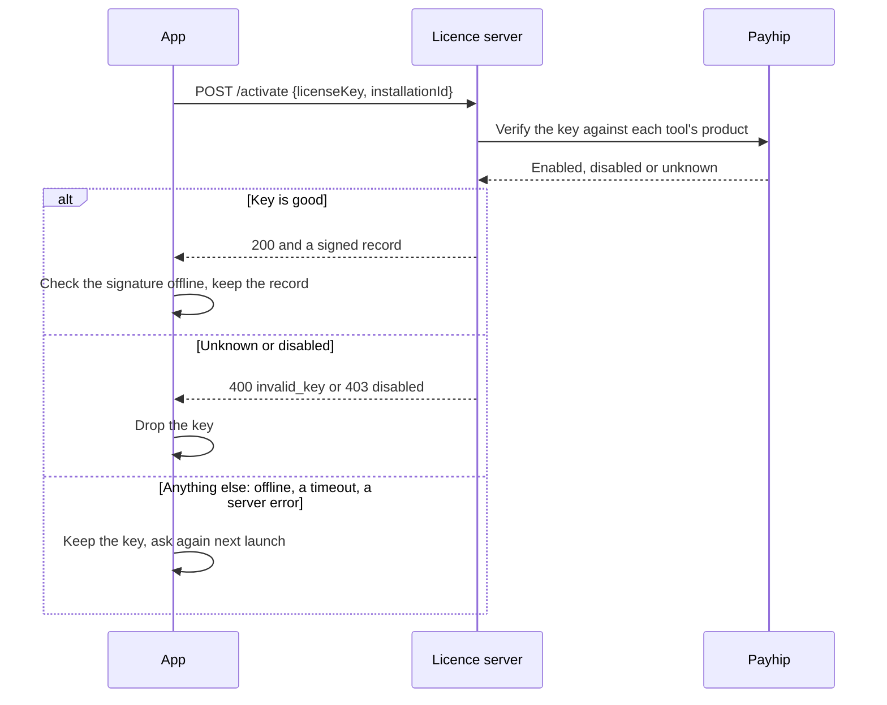

<!--
SPDX-FileCopyrightText: 2026 overpolish
SPDX-License-Identifier: Elastic-2.0
-->

# Licensing

Who may use the paid tools, listed in `Tool` (`src/tool.rs`). The crate decides; the app sends the requests, saves the state (`LicenseState`) and passes the time in.

## Whether a tool may open

Every paid tool (the list is `Tool`) shares one 14-day trial, which starts the first time any of them is used. After it, each tool needs a key bought for it. A key held here counts only while its record verifies: signed by the licence server, for this installation and for that key.

Each paid tool asks once, where it starts: `annotate::start`, `ruler::start`, `references::open` and Glide's `session::begin`, through `licensing::allow` in the app (`src-tauri/src/licensing.rs`). A Glide gesture after the trial shows the same lock as a window that cannot move, and opens Settings only the first time in a run, so a hand that glides out of habit is not sent to Settings each time. The app keeps the state in `license.json` beside its settings, and Settings › Licences (`src/features/settings/licences`) shows each tool's state, adds and removes keys and opens the checkouts.

## Adding a key, and checking it again

The app asks the licence server when a key is added, when a held key has not been confirmed for 21 days, and when a held record stops verifying (after a new server key, for example). Only the server's two named refusals take a key away; without a clear answer the key stays, so a tool never closes for someone offline. Payhip disables a key when its order is refunded, which reaches the app at its next check.

The server is the Worker in `workers/license`, whose README lists every answer it gives. The app's side of its answers is fixed by `ActivationOutcome::from_response`, and its address and public key by `src/server.rs`. A record is the claims' JSON (`entitlements`, `keyHash`, `installationId`, `issuedAt`, optional `email`) and a P-256 signature over its exact bytes, both base64; the signature is r and s of 32 bytes each, as WebCrypto signs on the server. The test in `src/tests/contract.rs` holds a record WebCrypto signed, so a change on either side that breaks the other fails there.
