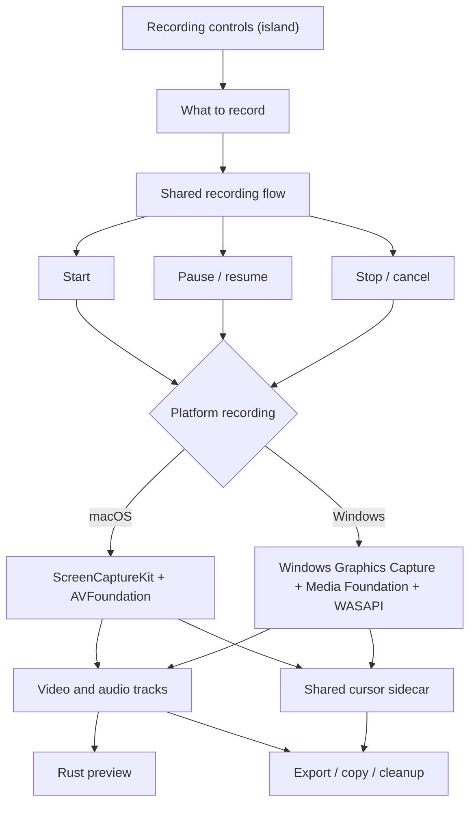
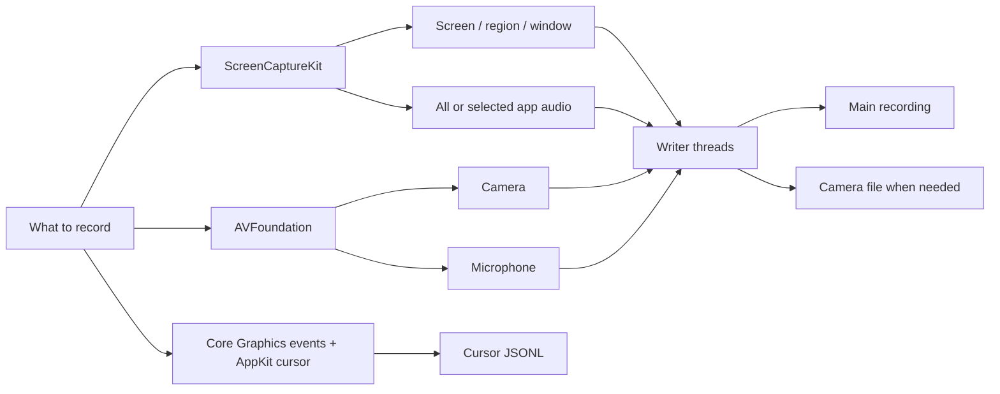
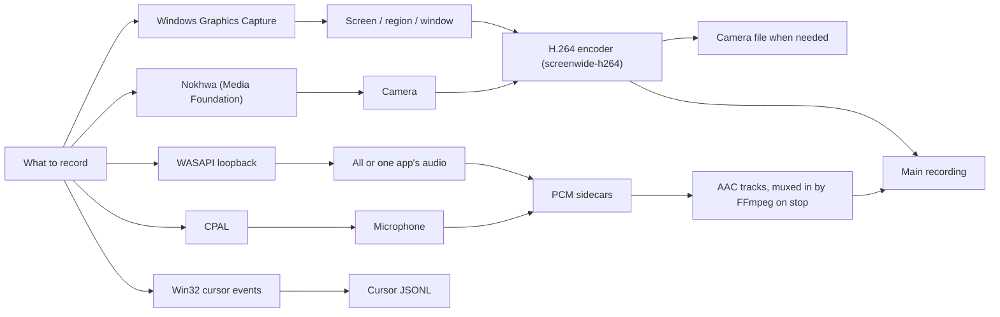

<!--
SPDX-FileCopyrightText: 2026 overpolish
SPDX-License-Identifier: GPL-3.0-or-later
-->

# Recording

## Shared

There is one recording flow for both platforms. It handles:

- modes and selected sources
- start, pause, resume, stop and cancel
- recording state
- the project each recording is written into
- timing and export info

### Projects

Every recording is a project: a folder in the projects folder (Settings, or `Movies/Screenwide` on macOS and `Videos\Screenwide` on Windows) named after the moment it started. Capture writes the movie, camera, cursor and keyboard tracks straight into its `media/` folder, and `session/begin.rs` writes the `<title>.screenwide` manifest as soon as the capture runs, so a project survives the app dying mid-recording and opens like any other. Stopping rewrites the manifest with the tracks that were actually written; the editor then saves its edit and its look (canvas, cursor, keyboard overlay, camera bubble, tracks and volumes) into the same manifest as they change, so a project reopens exactly as it was left (`src-tauri/crates/project/src/lib.rs`, `editor/project_look.rs`). A background picture the look shows and the pictures its images show are copied into `media/pictures/`, and opening or closing the project removes the ones it no longer uses (`project_look/cleanup.rs`). The editor also keeps `preview.png` beside the manifest, the edited frame the project browser shows. Exporting copies out of the project and leaves it as it was, unless the export window's "Delete project after saving" is ticked: then the project goes to the Trash once the files are written. A new recording can start while another is open, since the open one is already saved. Discarding a recording marks its folder cancelled before teardown and deletes it after; a launch finishes any deletion the previous run did not.

Screenshots are projects too (`editor/screenshot_project.rs`): the first capture makes one, each capture taken while the screenshot editor is open is added to it as another layer, and closing the editor keeps it. Captures copied to the clipboard alone make none.

A project's name is its folder's and its manifest's. Renaming one that no editor has open renames both at once. One open in an editor cannot be renamed under it, since the editor holds its files and Windows will not rename a folder holding an open file: the new name is kept in the manifest's `title` and shown everywhere at once, and the folder and manifest take it when the editor lets the project go (closing, a finished export or copy, or another project opened in its place), or when it is next opened if the app stopped first (`editor/project_name.rs`).

The app owns the `.screenwide` type (`bundle.fileAssociations`), so double-clicking a manifest opens its project in the editor for its kind, in place of whatever that editor had open. The dev bundle (`scripts/macos-dev-info.plist`) only registers as an alternate handler, so a project double-clicked on a Mac with the release installed opens in the release. macOS delivers the file as an open event (`startup::open_files`); Windows passes it as a launch argument, and the single-instance plugin hands a second launch's arguments to the running app. Open Project in the tray picks one by hand.

The platform part only needs to provide:

- `begin_blocking(config)` to start capture
- `CaptureSession` with pause, resume, stop and cancel
- `CaptureStart` with the first written frame, shared clock, source scale and cursor bounds

The platform is picked at compile time. It is not a plugin system. The platform parts, the cursor and keyboard writers, the encoding and the replay rings live in the `screenwide-capture` crate (`src-tauri/crates/capture/src`); paths below starting `platform/`, `platform_windows/`, `sidecar_output.rs` and `note_gate.rs` are there. This folder keeps the session, state, replay control and windows around them.

### Inputs and failures

A start never goes ahead without an input the user chose. Before the countdown, `session/inputs.rs` checks that the selected microphone still exists and that the selected camera still offers the exact size and rate asked for, and fails the start if either is gone; the replay buffer runs the same check. The camera answer comes from `recording_inputs/camera_mode.rs`, which uses the lookups the camera start itself makes (`camera_format::resolve_exact_camera_format` on Windows, `camera_frame_rate::find_format` on macOS), and the recording controls poll the same reader through `get_camera_mode_status`, so the warning on the camera control and the start cannot disagree. The island names the problem in itself, under its row.

Failures the user has to hear about go through `session::report_failure` and `replay::report`, which emit the usual error events and hand a translated title and an English reason to `failures.rs`. It queues them and the recording island says the one in front as an error line, `title: reason`, with OK at its end: above what will be recorded when idle, in place of any input warning, and under the recording's row during a recording (unless the annotate tools hang there). Failures are events, not conditions, so unlike the input warnings they do not clear themselves: each stays until OK dismisses it, and the next waiting takes its place, so none is lost. Starting a recording clears them all, as they belong to earlier attempts. One identical to a failure already showing or waiting is dropped, so retrying a start that keeps failing for the same reason leaves a single line. The queue lives in Rust rather than the island's page so a failure reported before the page listens, or while another island holds the window, is still said once the recording controls show. A failure can come from the tray, a shortcut or a wake with nothing of Screenwide's on screen, so a report brings the island out when the recording is idle and the controls are hidden; a start that failed brings them back itself once idle. Rejections by the state machine, such as a second Stop, only emit the event.

Debug builds can fake each failure with `SCREENWIDE_FAULT` (`fault.rs`): `pnpm dev:recording-failures camera-mode,stop` runs the app with the camera mode reading as gone and stopping failing. The names are `camera-mode`, `microphone`, `recording-start`, `capture`, `stop` and `replay-start`. Release builds compile it out.

### What a capture leaves out

Besides Screenwide's own windows (unless Include Screenwide in captures is on), General > Capture keeps desktop icons out (Hide desktop icons, on by default) and chosen apps (Hidden apps). The settings hand both to `screenwide_capture::chosen_exclusions` as they load and change (`settings/capture_exclusions.rs`), and each capture reads them as it starts. On macOS, `capture_kit::capture_exclusion` builds every recording's, replay's and screenshot's display filter: with no app chosen it lists windows (ours, and Finder's icons and the desktop widgets, which sit below every app window); with apps chosen it leaves the apps out whole, so a window one opens mid-recording stays out, Finder and Notification Center included for the desktop with their current windows excepted. Pictures the app takes for its own tools (Text Recognition, the Ruler, the magnifier, the window-pick backdrop) leave nothing chosen out. Windows cannot leave another program's window out of a capture, so there the chosen apps hide themselves: as a recording's capture opens (`session/begin.rs`), `hidden_apps_windows.rs` has `screenwide_window_hiding` load the window hider library (`src-tauri/window-hider`, built by `pnpm window-hider:prepare` and bundled beside the app) into each process of a chosen app that owns a visible window, and start its `screenwide_hide`, which keeps each window's display affinity and sets `WDA_EXCLUDEFROMCAPTURE`, and every 100 ms does the same for windows opened since. Back at idle, `screenwide_restore` gives each window its own setting back and the library is unloaded. The processes are written to `hidden-windows.txt` in the app's data folder before they are touched, so a Screenwide that stops mid-recording gives them back as it next starts. Hidden this way, the windows are hidden from every capture, video calls' included, while the recording runs. Settings offers only apps Screenwide can open for this (`list_hideable_applications`): not one running as administrator, a protected one, or one built for another processor. Screenshots and the replay buffer do not hide apps on Windows. `desktop_icons.rs` hides Explorer's icon view on screen while a recording of the screen or a region runs, or while the replay buffer is starting or on for one, so replay clips leave the icons out as they do on macOS; it shows the view again once neither needs it.

Recording > Video can also keep the system's bars out of screen recordings: Hide menu bar (the taskbar on Windows) and Hide Dock (macOS). These crop rather than leave a window out, since Windows cannot leave another app's window out of a display capture, and on macOS the menu bar also carries the capture marks macOS draws while anything records. `recording/screen_bars.rs` reads how far each bar reaches in from the display's edges, from AppKit's `visibleFrame` on macOS (the top is the menu bar, any other edge the Dock) and the monitor's work area on Windows, at the moment it is asked, and a screen recording or replay with a bar chosen records the rest of the display through the region path (`session::capture_sources`). The island's display stills are cut to the same part (`recording_sources/monitor_thumbnails.rs`), so they show what will be recorded, and Settings shows the sample desktop recorded with and without its bars (the `systemBars` preview scene). A bar set to hide itself takes no room, so nothing is cropped and it shows over the picture when it slides out; a reach under 8 points counts as none, as macOS keeps a sliver free for a hidden Dock.

## macOS

- Screen, region and window use ScreenCaptureKit.
- System audio and selected app audio use ScreenCaptureKit, including audio only mode.
- Camera and microphone use AVFoundation.
- AVAssetWriter writes the files and uses hardware video encoding.
- Camera stays separate unless bake in is enabled on export.
- Microphone stays on its own track so it is easy to edit later.
- Cursor position, appearance and button changes use the same recording clock as the media writers. Pauses are removed once in the shared cursor writer.
- Cursor files use global logical coordinates and include the captured source bounds. The macOS part only translates native events and cursor styles into the shared format.
- macOS stops every ScreenCaptureKit stream when the Mac locks or sleeps. `platform/stream_recovery.rs` keeps each stream's recipe and rebuilds and restarts a stopped one about once a second until it runs again, so video resumes after unlock on the same timeline. The time on the lock screen holds the last frame.

### Window capture

A window recorded on its own (`sc::ContentFilter::with_desktop_independent_window`) carries a badge on macOS 27: macOS gives the captured app a small window-sharing window and draws it as a purple pill over the window's traffic lights, opaque, in every frame, and on screen. Any filter that names the windows or apps to capture does the same; one that names only what to leave out does not. Tested on macOS 27.0.1: a display including only the window, and a display including only its app, both badge it; a display excluding every other window, and a display excluding every other app, do not.

So a window is recorded from its displays (`platform/desktop_stream/window.rs`). Each display gets a stream that draws only the window's app, every other app left out (`capture_kit::app_only_filter`), and the compositor (`platform/desktop_compositor.rs`) cuts the window out of their frames where it stood when each frame was drawn: `platform/window_track.rs` reads the window's bounds every 4 ms on the host clock the frames carry, and `desktop_capture::window_pieces` places them. A window moving between displays is cut from each display it stands on. Apps opened during the recording are left out within a second (`WindowFilterRefresh`), which also brings a stream rebuilt after sleep up to date. The output keeps the window's starting size; a window resized since is fitted to it and centred, the rest black. Windows captures the window on its own and matches this: the capture's frame pool is remade at each new window size (`platform_windows/capture.rs`), and a frame at a size other than the starting one is fitted the same way (`desktop_capture::fitted_window`, drawn by `WindowFitter` in `platform_windows/desktop_compositor.rs`).

The cursor sidecar maps the pointer into the picture by where the window stood as the recording started, while the picture follows the window. So a window recording writes each pointer position and press where it would have been had the window stayed put: on the window as it stands then, carried to the window as it started, scaled and centred as a resized window is fitted (`cursor/follow_window.rs`, reading the window's bounds at most every 4 ms: the window server's on macOS, DWM's extended frame bounds on Windows). The file keeps its format; a window recording's positions are no longer the pointer's place on the screen.

Other apps never show over the window. What this gives up against a window captured on its own: the part of the window off every display, and a window on another Space or under a full-screen app, are not recorded. The window's own app's other windows, menus and sheets show where they overlap it, as they are seen (user confirmed, 2026-11-04).

A display has nothing to show outside the window's rounded corners but black, so the movie has its corners black. As the capture starts, a still of the window alone (`SCScreenshotManager`, which carries no badge) has them clear; the smallest circle that leaves out every clear pixel of its top corner (`desktop_capture::corner_radius`) is kept with the recording (`RecordingManifest::corner_radius`, in the movie's pixels), and the compositor cuts the picture and its shadow to it (`source_shape` in `preview.wgsl`), so the background shows there as it showed on screen. Windows draws the corners clear in the window's own capture, so there the radius is read the same way off its first frame (`platform_windows/window_corner.rs`) and kept as the recording stops. An export of such a window always composes. Windows recorded before this have none and stay square.

Rejected:

- Patching the badge with real pixels from a second, small display stream over the window's traffic-light corner. The badge would still be on screen, and the corner would show whatever lay over it there.
- Painting over the badge in a shader. The badge is opaque, so what is under it (the traffic lights in their state, and a titlebar or sidebar material that shows the desktop through it) is not in the frame and could only be guessed.
- Recordly's fix (PR #877 in webadderallorg/Recordly, v1.4.0): record the display and crop each frame to the window's Accessibility frame. It records whatever covers the window, which leaving the other apps out avoids.

## Sleep

`recording/sleep.rs` decides what capture does when the computer sleeps, on every platform; `sleep/platform_*.rs` only report the moment (NSWorkspace notifications on macOS, the power manager's suspend and resume callback on Windows). A running recording is paused as if the user had pressed Pause and stays paused after the wake; a recording still counting down is discarded. The replay buffer turns off and, once the computer wakes, back on with the settings it had (`replay/sleep.rs`). Locking without sleeping changes nothing.

## Moments

A moment flags a point in a recording for whoever edits it. Each kind (Funny and Notable to begin with, edited in Settings) has a shortcut, and `src-tauri/src/moments/shortcuts.rs` claims those shortcuts only while a recording runs or is paused, so other apps keep the keys otherwise; the claim moves on a later turn because recording transitions arrive inside native shortcut callbacks. A press is placed 2 s before it, on the same pause-removed clock as the other sidecars, and written at once to `media/moments.jsonl` with the kind's name and colour as they were (`src-tauri/crates/moments/src/recorder.rs`). Presses during the countdown or while paused place nothing, and a recording with no moments keeps no file. The keyboard sidecar leaves the kinds' shortcuts out, so they never show as keystrokes. The island shows the kind in place of the timer for a moment; there is no sound, since system audio would record it. The editor reads the moments through `get_recording_moments` and pins the ones the edit keeps over the ruler; they cannot be moved.

Holding a kind's shortcut past 300 ms also records a voice note (`src-tauri/crates/moments/src/voice.rs`), unless voice notes are off in Settings. The note's microphone opens as the key goes down and a tap closes it with nothing kept. It is the recording's own microphone when Settings says "Same as Recording" and the recording has one, in which case the note is taken from the recording's stream rather than opening the device twice; otherwise it is the chosen microphone, or the system default. A note never opens a microphone the app has no permission for: Settings asks when notes are switched on. While a key is held the recording's microphone is held back (`note_gate.rs`) until the hold is known: a tap lets it through untouched, a note is written as silence from key-down to release, keeping the track's length and sync. Away from a hold nothing is delayed. Each note is a mono 16-bit WAV at `media/notes/<n>.wav`, the `n`th moment's, listed in `moments.jsonl` once written. The island shows the note's timer while the key is held, with a level meter of what the note hears when the island's confidence checks are on, and hides the recording's microphone meter meanwhile, keeping its space so the island does not change width; the note's level goes through the same monitor channel as the recording's meters (`monitor.rs`), measured from the note's own samples since its microphone may not be the recording's. The editor opens a note from its pin in the shared popup panel.

## Replay buffer

The replay buffer keeps the last 30 seconds of whatever the recording controls were set to when it was turned on: screen, region, window, camera or audio, with system audio, microphone and camera as selected. It runs beside recordings, not as one: the island and recording state never see it, and a recording can start and stop while it runs. Changing the controls afterwards sets up the next recording, not the buffer.

- `recording/replay.rs` owns the on/off state, saving and the `replay://state` event. It is driven from the island's switch, the tray and the Save Replay shortcut, which is only registered while the buffer is on. The tray's Turn On item emits `replay://start-requested` to the island, which starts the buffer with its current settings exactly as its switch does, because only the island's webview holds them. When the island's readiness check rejects those settings, or Rust rejects the start or the capture fails, the island comes out, and its input warnings say what stopped it. While it runs the tray shows a rewind mark over its arc, unless a recording or a Delayed Screenshot countdown has something to show.
- The macOS capture opens the same streams a recording does (`platform/startup.rs` with `Sink::Replay`). Its writers (`platform/replay/`) encode video with their own VideoToolbox sessions and keep the encoded frames back to the keyframe a full-length clip must start from; audio is kept as PCM and encoded only when a clip is saved. A quiet screen is re-encoded as a keyframe every second so a clip never reaches back to its last change.
- The Windows capture opens the same streams through `platform_windows/startup.rs` with a replay length. Its writers (`platform_windows/replay/`) convert each frame to NV12 on the GPU and hand it to the H.264 encoder of the `screenwide-h264` crate, which a recording and an export use too: hardware first, with Microsoft's software encoder as the fallback, keeping the encoded samples. Frames are encoded at no more than the capture's frame rate, the newest one winning. Microphone and system audio go to in-memory rings (`platform_windows/audio/ring.rs`) instead of sidecars. A save writes the clip's frames to an MP4 through the Sink Writer in passthrough, which keeps every frame's own time, then writes the audio stretch as raw sidecars and muxes it exactly as a recording's audio is muxed. An encoder that ignores keyframe requests is restarted for the keyframes a save and a quiet screen need.
- Both platforms cut clips with the same rules (`replay_ring.rs` in the capture crate).
- A save holds what happened since the previous save, capped at 30 seconds. The save encodes the last frame again as a keyframe at the moment of the save, which ends that clip and is exactly where the next one starts. A camera beside the screen forces its keyframes right after the screen's so both start together. Turning the buffer off forgets where the last save ended.
- Cursor and keyboard keep their recent records in memory (`sidecar_output.rs`) and live annotations keep their recent visible spans; a clip restates the cursor, held buttons and keys, and annotations already on screen at its first frame.
- A saved clip is written as a project of its own, named for the moment it was saved, given the same first edit a recording gets (live annotations and auto zooms), and added to the recent projects. Nothing opens: the tray shows a tick in place of its icon for a moment (`tray/replay_saved.rs`), and the clip is in the project browser.
- Sleep turns the buffer off and a wake turns it back on; see Sleep above.

## Windows

- Screen, region and window use Windows Graphics Capture (`platform_windows/capture.rs`). Its D3D11 textures are converted to NV12 on the GPU and encoded by the graphics card's H.264 encoder, which the `screenwide-h264` crate drives itself and shuts down when the file is done: a Sink Writer that makes a hardware encoder never lets it go, and kept a Direct3D device for every recording. The Sink Writer only muxes the encoded frames into a fragmented MP4. Nothing is copied to the CPU and no FFmpeg process runs. Each frame keeps the time it was captured, so a screen that does not change leaves a gap rather than repeated frames, as on macOS.
- The camera comes through Nokhwa as the device's own YUYV or MJPEG buffers. Decoding them is the one step on the CPU; the frame goes up to D3D11 and on to the same writer, in a file of its own as on macOS.
- The computer's sound, or one app's, uses WASAPI loopback (`platform_windows/audio/system.rs`); the microphone uses the same CPAL capture as macOS (`microphone.rs`).
- Media Foundation's MP4 sink takes only one audio stream, so the microphone and the computer's sound are written as timestamped PCM sidecars, and muxed in as tracks of their own once the video is finished (`platform_windows/audio/mux.rs`). The video is copied as it is, so this decodes and redraws nothing.
- Cursor events are read from Win32 and written in the shared cursor format (`cursor/platform_windows.rs`): artwork and geometry, never pixels, as on macOS.
