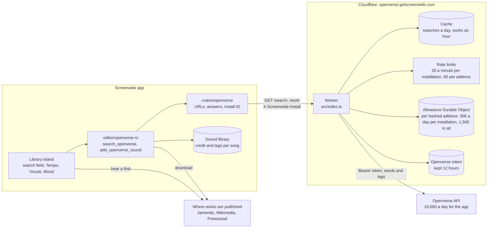
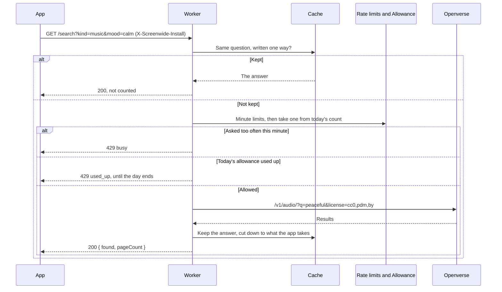

<!--
SPDX-FileCopyrightText: 2026 overpolish
SPDX-License-Identifier: GPL-3.0-or-later
-->

# Openverse search

The Cloudflare Worker at `openverse.getscreenwide.com` that the Library island searches Openverse through (`src-tauri/crates/openverse`). It holds the app's Openverse registration, so the client secret never ships in the app and no one can take it to use up the searches every user shares. It only ever answers with what may be used with no more than a credit: public domain, CC0 and CC BY, never ShareAlike, NonCommercial or NoDerivatives.

## How it fits together

Only searches and the check as a work downloads go through the Worker. Hearing a find and downloading it go straight to where it is published, so the Worker never carries a file. Songs in the library are described locally: a downloaded one by the tags it came with, one added from a file by its measured beat and, once heard by the separation model, its singing (`src/features/editor/island/DECISIONS.md`, Library island).

A question the cache can answer costs Openverse nothing and is not counted. Any other is checked against the asker's allowance before it is sent on:

## Answers

`GET /search?kind=music|effect|image&q=…&page=1` (pages 1 to 12, 20 results each). Music also takes `tempo=slow|medium|fast`, `vocals=instrumental|vocal` and `mood=happy|uplifting|energetic|calm|dreamy|romantic|sad|dark|epic`, and may be searched by these alone, without `q`:

| Answer | When |
| --- | --- |
| `200 { found, pageCount }` | Openverse answered; `found` is cut down to what the app shows and credits |
| `400 { "error": "unknown_kind" \| "bad_query" \| "bad_filter" \| "bad_page" }` | The search is not one the app makes |
| `429 { "error": "busy" }` | The asker has asked too often this minute (see Allowances), or Openverse is rate limiting the app |
| `429 { "error": "used_up", "until": <ms since the epoch> }` | The asker has used today's allowance, which comes back at `until`, the end of the day (UTC) |
| `502 { "error": "upstream" }` | Openverse could not answer |
| `500 { "error": "not_configured" }` | A secret is missing |

Songs are searched as Openverse's `short` and `medium` lengths (30 seconds to 10 minutes), from Jamendo and Wikimedia but not Freesound, whose long sounds are loops and field recordings; sound effects as `shortest` (under 30 seconds). Openverse has no fields for tempo, vocals or mood, so each filter is one of the tags Jamendo gives its tracks (`speed_low`, `instrumental`, `peaceful`), added to the words searched, all of which Openverse requires. Jamendo's MP3s, which Openverse calls `mp32`, are answered as `mp3`. Each result carries `tags`: its `genres`, and its `tempo`, `vocals` and `moods` in the filters' words, read back from the same Jamendo tags, so the library can keep them and narrow a downloaded song as it was found. A track tagged both ways for one filter, such as both `instrumental` and `vocal`, has none for it. The app's token, which lasts 12 hours, and every answer, for a day, are kept in the data centre's cache.

`GET /work?kind=music|effect|image&id=<Openverse id>` looks one work up again, which the app does as it downloads it, so a work taken down or moved to a licence the app may not use is not added, and its credit is as it stands now:

| Answer | When |
| --- | --- |
| `200 { found }` | `found` is the work as a search answers with it, or `null` where it is gone or no longer under a licence the app may use |
| `400 { "error": "unknown_kind" \| "bad_id" }` | The id is not an Openverse id |

It counts against the same allowance, answers `429` and `502` as a search does, and is kept for an hour.

## Allowances

The app's registration allows 10,000 questions a day and 100 a minute across everyone (Openverse's `standard` model; `GET https://api.openverse.org/v1/rate_limit/` with the app's token says which model it is on and how much is used today). So that no one uses that up for the rest, each question this Worker sends on to Openverse is counted against the asker; an answer already in the cache costs Openverse nothing and is not counted.

- The app sends a random ID made for its installation in `X-Screenwide-Install` (`src-tauri/crates/openverse/src/install.rs`), separate from the licence's, so people sharing an address are told apart. Askers sending none, as older apps do, count as one person at their address.
- Each installation at an address may send on 20 a minute and 300 a day.
- Each address may send on 60 a minute and 1,500 a day, however many installations it names, as an ID costs nothing to make up.

The minute limits are Cloudflare rate limits. The day's counts are kept in a Durable Object for each address (`Allowance`), named by a hash of the address so the address is not stored, and deleted when the day ends (UTC).

## Secrets

Set each with `pnpm wrangler secret put <NAME>` from this folder, entered at the prompt, never typed into a command:

- `OPENVERSE_CLIENT_ID` and `OPENVERSE_CLIENT_SECRET`: the app's registration with Openverse (`POST https://api.openverse.org/v1/auth_tokens/register/`), whose email has been confirmed.

## Work on it

- `pnpm --filter screenwide-openverse-worker typecheck` writes the Worker's types (`wrangler types`) and checks them.
- `pnpm exec vitest run workers/openverse` runs its tests, with Openverse faked.
- `pnpm --filter screenwide-openverse-worker dev` runs it locally; it reads the secrets from a `.dev.vars` file here, which git ignores. Start the app with `SCREENWIDE_OPENVERSE_URL=http://localhost:8787` to ask it rather than the published Worker.
- `pnpm --filter screenwide-openverse-worker deploy` publishes it, after `pnpm wrangler login`. The custom domain needs the `getscreenwide.com` zone on the same Cloudflare account.
